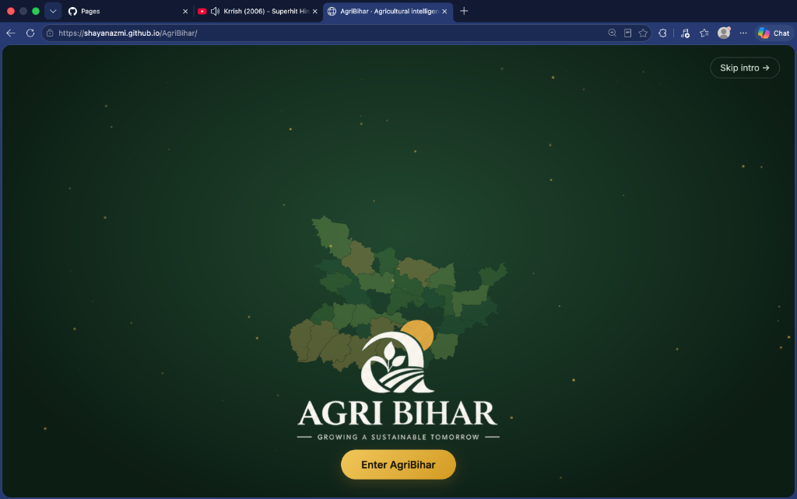
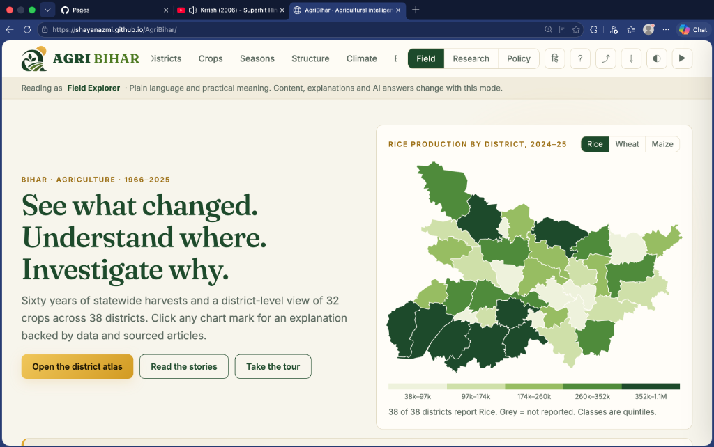
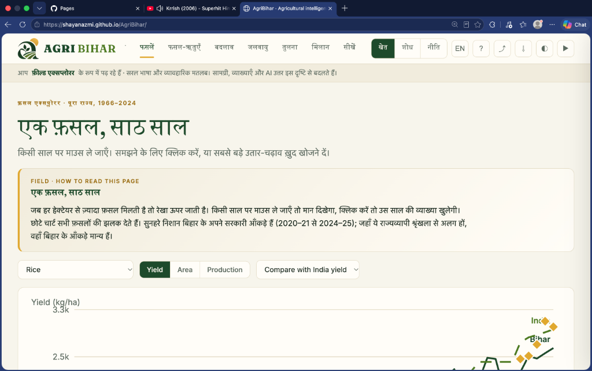
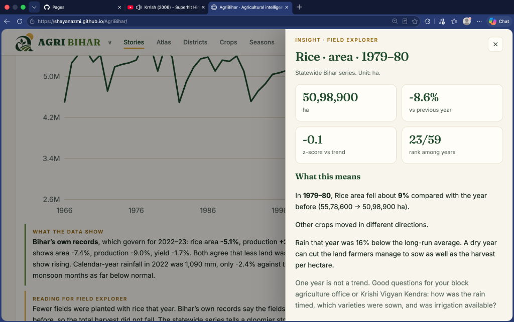

<div align="center">

# 🌾 AgriBihar
### Agricultural Intelligence & Climate Insights for Bihar

Sixty years of farm data, 38 districts, and grounded AI to see what changed, where it changed, and why.

[](https://shayanazmi.github.io/AgriBihar/)
[](https://github.com/shayanazmi/AgriBihar/network/members)
[](https://github.com/shayanazmi/AgriBihar/issues)
[](./LICENSE)

[](https://developer.mozilla.org/en-US/docs/Web/JavaScript)
[](https://developer.mozilla.org/en-US/docs/Glossary/HTML5)
[](https://developer.mozilla.org/en-US/docs/Web/CSS)
[](#-fast-private--works-offline)
[](#-bilingual-english--%E0%A4%B9%E0%A4%BF%E0%A4%A8%E0%A5%8D%E0%A4%A6%E0%A5%80)

<br />

| 📍 Districts | ⏳ Years Covered | 🌾 Crops Included | ⚡ App Speed | 🌐 Languages |
| :---: | :---: | :---: | :---: | :---: |
| **All 38 Districts** | **1966 – 2025 (60 Years)** | **32+ Crops (4 Seasons)** | **Instant (Zero Build)** | **English & हिन्दी** |

<br />

<p align="center">
  <a href="https://shayanazmi.github.io/AgriBihar/"><strong>👉 Launch the Live Website »</strong></a>
</p>

<p align="center">
  <a href="#why-this-exists">Why This Exists</a> •
  <a href="#visual-tour">Visual Tour</a> •
  <a href="#features">Features</a> •
  <a href="#data-sources">Data Sources</a> •
  <a href="#quickstart">Quickstart</a>
</p>

<a href="https://shayanazmi.github.io/AgriBihar/">
  
</a>

</div>

---

<a id="why-this-exists"></a>
## 🌾 1. Why This Exists: The Bihar Reality

Bihar has some of the most fertile agricultural soil in the world. Over **104 million people** live here, and **7 out of 10 workers** depend on farming to feed their families. 

Yet agriculture in Bihar faces extreme, unpredictable weather every year:
* **Floods in the North:** 28 districts regularly get flooded by rivers flowing down from the Himalayas. Bihar holds about **17% of all flood-prone land in India**.
* **Droughts in the South:** At the exact same time, southern districts often face delayed monsoons, dry wells, and cracked soil.
* **State Averages Hide the Truth:** If you only look at overall state averages, everything looks smooth. But statewide numbers lie: one district can have a bumper harvest while a neighboring district suffers a total crop failure.

> **The Core Rule:** You cannot help farmers with state-wide averages. You need to know what happened in *their* district, in *that* specific season, for *that* specific crop.

---

<a id="visual-tour"></a>
## 📸 2. Visual Tour: See It in Action

### Step 1: Look at the District Map
Spot which districts are thriving and which are falling behind across winter, summer, and autumn crops.

<p align="center">
  
</p>

---

### Step 2: Trace 60 Years of History (in English or Hindi)
See how harvests changed from 1966 to today, compared against all-India averages. Switch to full Hindi (हिन्दी) with one click.

<p align="center">
  
</p>

---

### Step 3: Click Any Year for an AI Explanation
Click any dip or jump on the chart. The AI explains what the data shows, what might have caused it (like a drought year), and what questions to ask your local Krishi Vigyan Kendra (KVK).

<p align="center">
  
</p>

---

<a id="features"></a>
## 🚀 3. Key Features

### 🗺️ Interactive Map of All 38 Districts
* **Every Single District:** Clear maps of all 38 modern districts of Bihar.
* **Color-Coded Rankings:** Easily see top-producing areas and struggling zones.
* **All 4 Cropping Seasons:**
  * **Aghani** (Winter rice harvest)
  * **Bhadai** (Early autumn crops)
  * **Garma** (Summer crops)
  * **Rabi** (Winter wheat, pulses, and mustard)

### 📈 60 Years of Crop History (1966–2024)
* **Six Decades of Trends:** Track how yields improved from the early Green Revolution to today.
* **India vs. Bihar Comparison:** See where Bihar beats the national average and where a yield gap remains.
* **32+ Crops:** Cereals (Rice, Wheat, Maize), Pulses (Gram, Lentil, Arhar), Cash crops (Sugarcane, Jute, Potato), and Oilseeds.

### 👓 Three Reading Modes
AgriBihar changes its wording and detail based on who is reading:

| Reading Mode | Who It Is For | What It Focuses On | Practical Output |
| :--- | :--- | :--- | :--- |
| **🌾 Field Explorer** | Farmers and field workers | Simple words, clear explanations, zero academic jargon | Practical questions to ask your local Krishi Vigyan Kendra (KVK) |
| **🔬 Research Lab** | Students and researchers | Statistics, $z$-score deviations, and data boundaries | Testable ideas and clear research notes |
| **🏛️ Policy Observatory** | Government officers and planners | Big-picture gaps, crop price alignment, and district needs | Where to target resources and support |

### 🤖 Grounded AI Assistant
* **No Wild Guesses:** When explaining a bad drought or a sudden drop in harvest, the AI breaks its answer into three clear boxes:
  1. **Documented:** Facts directly proven by the official numbers.
  2. **Possible Explanations:** Likely weather, seed, or soil causes.
  3. **Unknown:** Things the data cannot answer, so nobody gets misled.

<a id="bilingual-english--हिन्दी"></a>
### 🌐 Bilingual (English & हिन्दी)
* One click switches the entire website between English and natural Hindi (हिन्दी / देवनागरी).
* Uses real, familiar farming terms (*अघनी*, *भदई*, *गरमा*, *रबी*, *कृषि विज्ञान केंद्र*).

<a id="built-for-speed-and-privacy"></a>
### 📄 Fast, Private & Works Offline
* **Zero Waiting:** Built with pure web code (HTML, CSS, JavaScript). No heavy frameworks that slow down older phones.
* **Download PDF Reports:** Export printable summaries for any crop or district in one click. Everything happens right on your device—none of your reading data is tracked or uploaded.

---

<a id="data-sources"></a>
## 📊 4. Where the Data Comes From

All data comes directly from official, publicly accessible records:

| Source | Years | What It Covers | How We Verified It |
| :--- | :--- | :--- | :--- |
| **Directorate of Economics & Statistics (DES), Bihar** | 2014 to 2025 | All 38 modern districts | 13,336 crop records parsed from official portals; re-calculated every yield figure to catch rounding errors. |
| **Ministry of Agriculture, Government of India** | 1966 to 2024 | Statewide Bihar & All-India | Continuous 60-year time-series harmonized across the 2000 state split. |
| **India Meteorological Department (IMD)** | 2000 to 2024 | Daily rainfall measurements | Gridded rainfall mapped to district boundaries to track monthly, monsoon, and annual rain. |
| **ICRISAT Database** | 1966 to 2017 | 11 Historical Parent Districts | Preserved original 1966 district borders so historic numbers remain statistically honest. |

---

<a id="quickstart"></a>
## ⚡ 5. Quickstart: Run It Locally

You do not need to install complex software, libraries, or build tools. If you have Python on your computer, you can run it in 5 seconds:

```zsh
# 1. Download the code
git clone https://github.com/shayanazmi/AgriBihar.git
cd AgriBihar

# 2. Start a simple web server
python3 -m http.server 8080

# 3. Open in your browser
open http://localhost:8080
```

---

## 📁 6. File Structure

```text
├── index.html              # Main website page (fast, accessible HTML5)
├── app.js                  # Interactive map, charts, and translations
├── config.js               # Configuration file
├── configure.py            # Simple script to update settings
├── fb.js                   # Security protection against embedding
├── theme-init.js           # Instant dark/light mode toggle
├── LICENSE                 # Apache License 2.0
├── assets/
│   └── screenshots/        # High-quality screenshots for this guide
├── fonts/                  # Clean offline fonts (Inter & Fraunces)
├── vendor/                 # Local PDF generation tool (jsPDF)
└── worker/                 # Secure AI proxy
    ├── agribihar-ai-worker.js # AI bridge that protects secret keys
    └── wrangler.toml          # Worker deployment settings
```

---

## 🚀 7. Publish to GitHub Pages

1. Push this folder to your GitHub account.
2. In your GitHub repository, click **Settings** → **Pages**.
3. Under **Branch**, select `main` and `/ (root)`.
4. Click **Save**. Your site will be online at `https://<your-username>.github.io/<repo-name>/`.

---

## 📜 License & Credits

* **Code License**: This project is free and open-source under the [Apache License 2.0](./LICENSE).
* **Government Open Data**: Directorate of Economics & Statistics (Bihar), Ministry of Agriculture (GoI), and India Meteorological Department (IMD).
* **Typefaces**: [*Inter*](https://rsms.me/inter/) by Rasmus Andersson and [*Fraunces*](https://undercase.xyz/) by Undercase Type (SIL Open Font License).

---

<div align="center">

**AgriBihar · Growing a Sustainable Tomorrow**  
Created with care by [Shayan Azmi](https://github.com/shayanazmi)

</div>
